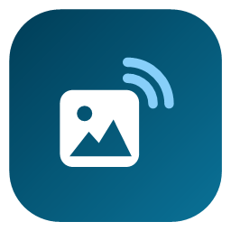

<div align="center">



# Pix Relay — Auto Mac Sync

**Automatically send photos &amp; videos from your Mac straight to a Pixel 1–4 over home Wi-Fi — so you can use its free, unlimited Google Photos backup.**

<p>
  
  
  
  
</p>

<br />

<a href="https://github.com/Aussie-App-Studio/Pix-Relay-Auto-Mac-Sync/releases/latest/download/Pix-Relay-Auto-Mac-Sync-Universal.dmg">
  
</a>
&nbsp;
<a href="PRIVACY_POLICY.md">
  
</a>

<br />
<br />
<sub>Works on every Mac (M1, M2, M3, M4 &amp; Intel) · No account required · <a href="PRIVACY_POLICY.md"><strong>Privacy Policy (Zero Tracking)</strong></a> · <a href="https://github.com/Aussie-App-Studio/Pix-Relay-Auto-Mac-Sync/releases/latest">All Releases</a> · <a href="LICENSE">License (All Rights Reserved)</a></sub>

</div>

---

## How to Install &amp; Open on Mac (Takes 30 Seconds)

> [!IMPORTANT]
> **Why does macOS show an "Apple could not verify" warning?**
>
> Apple charges every developer **$99 USD every year** for a paid Developer ID certificate just to hide that warning popup — even for completely free indie apps.
>
> **Nothing is wrong with the app.** It never even connects to the internet ([Privacy Policy](PRIVACY_POLICY.md)). Because we don't pay Apple's $99/year fee, you simply tell your Mac **once** that you trust it.

### Step 1: Install the App
1. Click the blue **Download for Mac (.dmg)** button above.
2. Double-click the downloaded **`Pix-Relay-Auto-Mac-Sync-Universal.dmg`** file.
3. Drag **Pix Relay Auto Mac Sync** into the **Applications** folder icon.

### Step 2: Bypass Apple's "Unverified Developer" Block (Pick Either Way)

#### Option A — Using Mac Settings (No typing needed · Works on macOS Sequoia, Sonoma &amp; Ventura)
1. Open your **Applications** folder and double-click **Pix Relay Auto Mac Sync**.
2. A popup will say *"Apple could not verify..."* or *"Not Opened"*. Click **Done** (or **OK**) — **do NOT click Move to Trash**.
3. Open **System Settings** (click the **** Apple logo in the top-left corner → **System Settings**).
4. Click **Privacy &amp; Security** in the left sidebar.
5. Scroll down to the **Security** section — you'll see a message saying *"Pix Relay Auto Mac Sync was blocked..."*.
6. Click **Open Anyway** → enter your Mac password or Touch ID → click **Open**.

That's it! You will **never** see that popup again.

---

#### Option B — 1-Line Copy &amp; Paste (Fastest · Also fixes "App is damaged" popups)
1. Press **⌘ Command + Spacebar**, type **`Terminal`**, and press **Enter**.
2. Paste this single line and press **Enter**:
   ```bash
   xattr -cr "/Applications/Pix Relay Auto Mac Sync.app"
   ```
3. Now open **Pix Relay Auto Mac Sync** from Applications normally!

---

## How to Start Syncing Photos to Your Pixel

1. **Open Pix Relay on your Backup Pixel (Pixel 1–4)** in **Receiver** mode (make sure your Mac and Pixel are on the same home Wi-Fi).
2. **Pair Once:** Open **Pix Relay Auto Mac Sync** on your Mac, go to **Pair Pixel**, and click **Pair** (or type the Pixel's Wi-Fi IP / paste its `PIX1:` code).
   - *Tip for macOS Sequoia (15+):* If macOS asks *"Allow Pix Relay to find devices on local networks?"*, click **Allow**.
3. **Pick What to Sync:**
   - **Apple Photos Users:** Click the **Sync Apple Photos Library** button right on the home screen (if macOS asks for permission, grant **Full Disk Access** in *System Settings → Privacy &amp; Security* and click **Recheck**).
   - **Folder Users:** Click **Add Folder** or drag any photo/video folder (or SD card folder) directly into the window.

---

## What It Does (In Plain English)

- **Syncs Your Apple Photos Library Safely:** Reads full-resolution originals straight out of your Mac's Photos Library **read-only** — it never edits, corrupts, or deletes anything inside Apple Photos.
- **Watches Regular Mac Folders Automatically:** Drop in your Camera Roll, Lightroom exports, Downloads, or external hard drive folders and new photos upload to your Pixel automatically in the background.
- **Safely Free Up Mac Hard Drive Space:** Once your Pixel confirms Google Photos has finished backing up a photo, Pix Relay marks it green (`Cleared by Pixel ✓`) so you can safely send the Mac copy to **macOS Trash** or an **Archive Drive** in one click.
- **100% Offline &amp; Zero Tracking:** Your photos go straight from your Mac to your Pixel over encrypted home Wi-Fi — the app never connects to the internet, has no accounts, and collects zero data. Read our [**Privacy Policy**](PRIVACY_POLICY.md).
- **Ultra-Lightweight Menu Bar Mode:** Closing the window tucks the app neatly into the top-right Mac Menu Bar using ~15 MB of memory.

---

## Privacy &amp; License

- **Privacy Policy:** [**Read Privacy Policy (`PRIVACY_POLICY.md`)**](PRIVACY_POLICY.md) — Pix Relay: Auto Mac Sync never connects to the internet and never tracks or collects your data.
- **License:** [**Proprietary — All Rights Reserved (`LICENSE`)**](LICENSE) — Free to download and use personally from official Aussie App Studio releases. Copying, modifying, or redistributing the code, assets, or app is not permitted.

<div align="center">
<sub>© 2026 Aussie App Studio · All Rights Reserved</sub>
</div>
